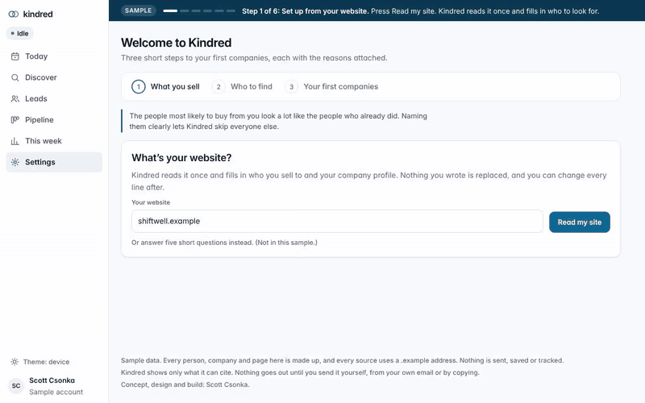
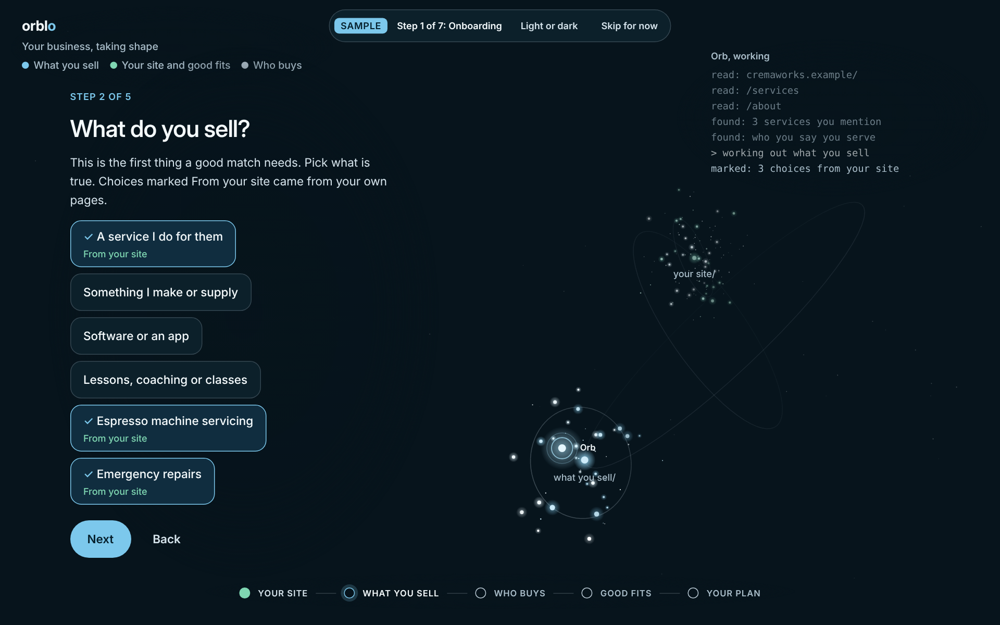
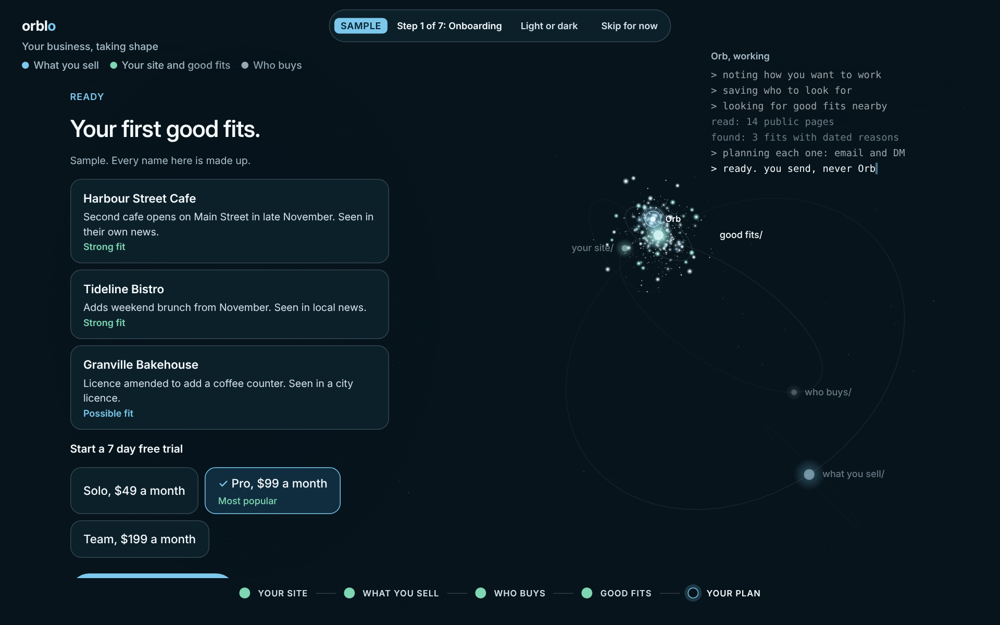
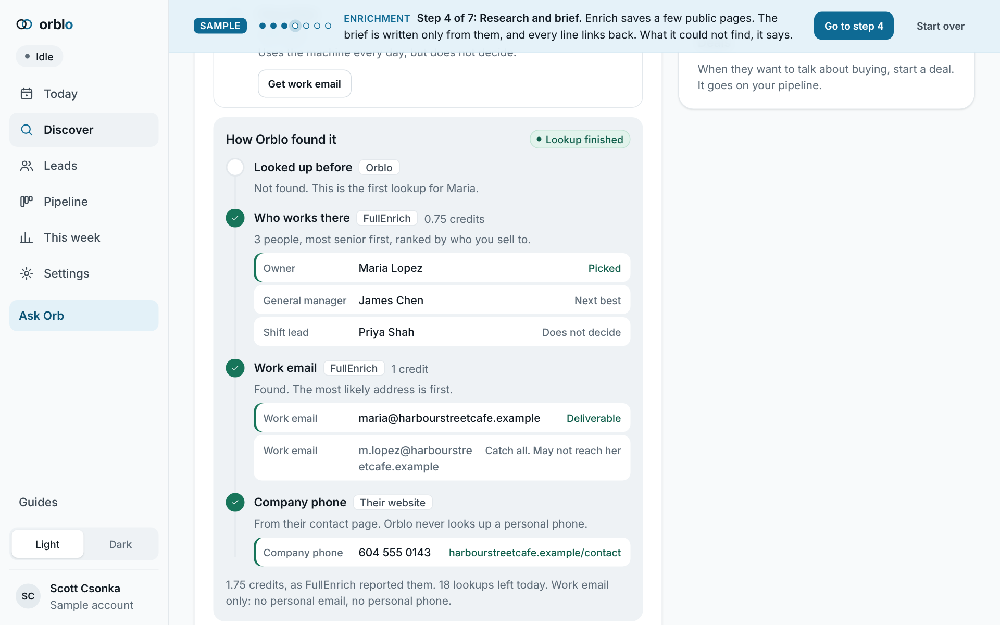
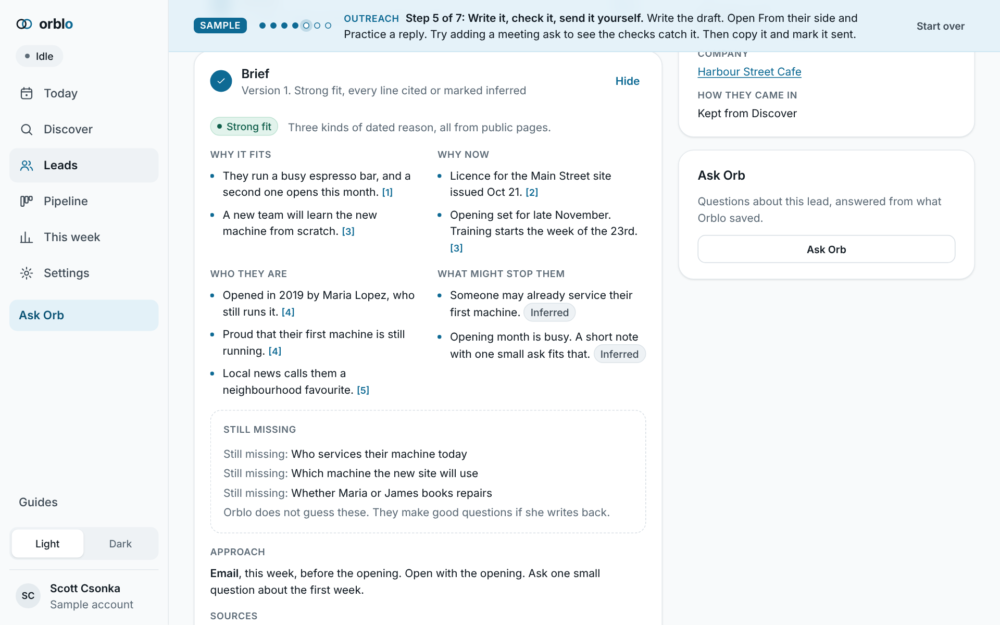
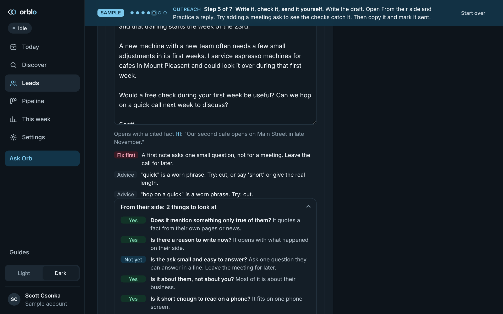
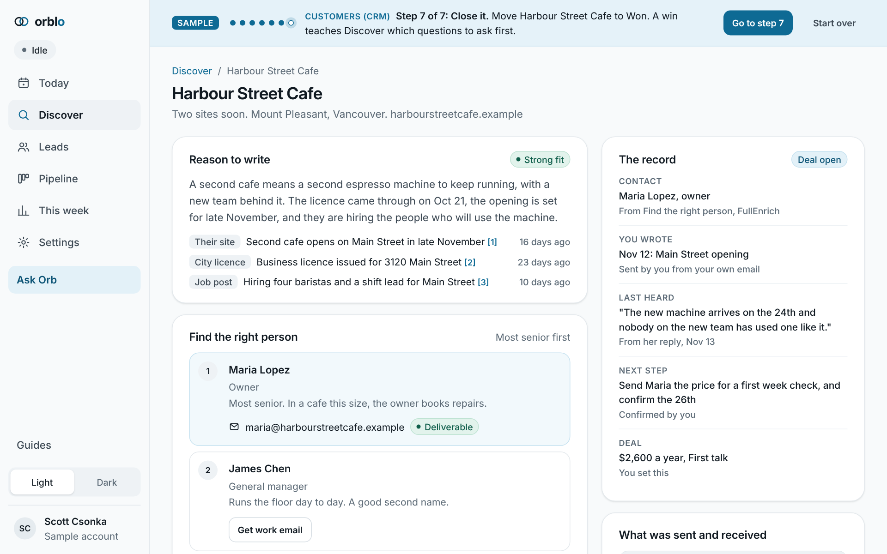
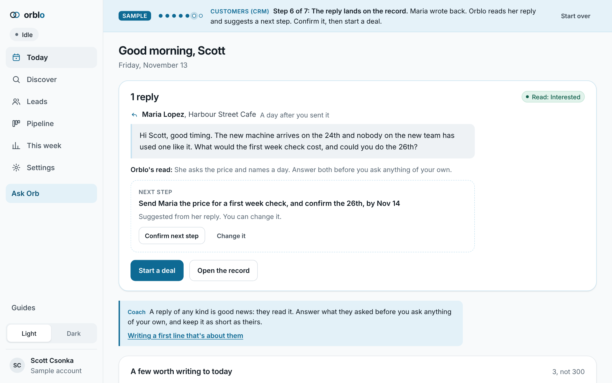
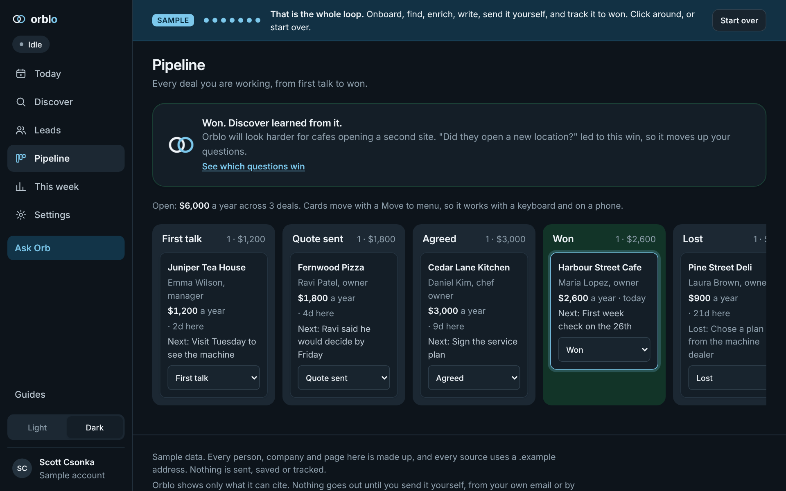

# Orblo: clickable sample

**Who to write to this week, and what to say.**

Orblo is a sales app for small business owners who have never had a sales team. It learns what you sell from your own website, finds a few businesses that need it right now, each with a dated public reason you can check, finds the right person to write to, and drafts a short note in your voice. You send it yourself. Replies land on the customer's record, and the deal moves to won.

**[Try the sample in your browser](https://csonkascott.github.io/orblo-demo/)**. No sign up. It takes about three minutes.

A guided ribbon walks you through seven steps across the four parts of Orblo. The sample seller, Crema Works, services espresso machines for cafes in Vancouver. Every name in it is made up.

## 1. Onboarding: Orb learns your business instead of guessing it

- **It reads your site first.** Orb reads a few of your own pages, then asks four short questions. Choices it found on your site come already marked **From your site**, so you mostly confirm instead of type.
- **The map is your business taking shape.** Each answer grows a cluster on a slowly turning orbital map. Orb travels to the cluster the question is about, and a log types out only the steps Orblo runs.
- **It ends with real results.** The last screen shows your first good fits, each with the reason it fits, before you pick a plan.
- Calm on purpose: no countdowns, nothing flashes, and a single still frame when reduced motion is on.

## 2. Discover: a few companies, each with a dated reason

- **Dated public signals from open data and official APIs:** city business licences, public job boards (Greenhouse, Lever, Ashby, Workable), dated local news, and each company's own site. Every reason links to its page and shows how old it is.
- **Your own questions.** Orblo asks the questions you write ("Did they open a new location in the last 60 days?") of every company it finds, and shows the answer.
- **Why now.** A short story built only from the dated reasons, never from guesses.
- **Strong only when it has earned it.** Strong needs two kinds of recent reason. Companies that do not qualify are left out, each with the reason why.

## 3. Enrichment: the right person, and how Orblo found them

- **Most senior first.** Find the right person asks a licensed data provider (FullEnrich) for the most senior people first, then ranks them by who you said buys from you.
- **A waterfall, not a black box.** Each step that ran is shown in order: looked up before, who works there, work email, company phone. Usable results are highlighted; a risky catch all address is shown in grey.
- **Honest costs and limits.** Credits come from what the provider reported, never an estimate, next to the lookups left today.
- **Work data only.** A work email and the company phone from their own contact page. No personal email, and no personal phone.

Then **Enrich** saves a few public pages, and the **brief** is written only from them. Every line links to its source or is marked inferred, and what Orblo could not find is listed as **Still missing** instead of guessed.

## 4. Outreach: a short note, checked from their side, sent by you

- **An email and a DM, written from the brief.** The note opens with what happened on their side, says why it matters, and ends with one small question.
- **Checks you can see.** A phrase check flags worn sales wording as you type, from a list of 150 phrases. A meeting ask in a first note, a long dash or a blank placeholder must be fixed before **Copy draft** works.
- **From their side.** Six plain questions a buyer would ask of the note ("Is the ask small and easy to answer?"), each answered Yes or Not yet with one line.
- **Practice a reply.** Orblo plays the person you wrote to (interested, a question, how much, not now), then looks at your answer. Nothing in practice is saved or sent.
- **A person always sends.** There is no send button in the sample and no sending in bulk or on a schedule in the app. You copy the note, or send it from your own Gmail or Outlook after you check who it goes to and press Send.

## 5. CRM: the place where your customers live

- **It fills itself.** The note you sent and the reply you got land on the right record on their own, with where each line came from. No end of day data entry.
- **Next steps read from replies.** Orblo reads the reply ("She asks the price and names a day"), suggests a next step with a date, and waits for you to confirm it.
- **A pipeline that learns.** Start a deal from the reply and move it to Won with a menu that works by keyboard and on a phone. A win teaches Discover which of your questions to ask first, and **This week** shows which questions earn replies.

Also in the sample: **Ask Orb**, which answers questions from what Orblo saved and says when something is missing, and short **guides** written for people who have never sold.

## How Orblo is built

The real app is private and invite only. This repo holds only the sample.

- **Stack:** Next.js 15 and React 19 on Vercel, Supabase (Postgres, auth and storage), Stripe billing with a 7 day trial, and the Claude API for research, briefs, drafts and reading replies.
- **Grounded output:** every claim in a brief or a note cites a saved source or is marked inferred. Gaps are stated, not filled. Text read from public pages is treated as untrusted data in every prompt and on every screen.
- **Data sources:** official APIs, licensed providers and open data only: business licence feeds from eight city open data portals, public job board APIs, GDELT for dated news, Google Places, FullEnrich for people and work emails. Every outside call goes through one cache with a timeout and a polite rate limit. The server never signs in to a site.
- **AI calls:** one wrapper for every model call, with prompt caching, a trace per call, daily call limits, a per person spend cap and a global daily ceiling.
- **Privacy and security:** row level security forced on every table, with tests that prove one account cannot read another's rows. The service role key lives in one file, checked by a test. Authenticator app sign in, an admin panel with an audit log, CodeQL and secret scanning in CI.
- **Quality gates:** about 240 Vitest files, 38 Playwright specs run against an in-memory Supabase stand-in (no real provider is ever called in a test), axe checks for WCAG 2.2 AA in light and dark, speed budgets for the full journey, a draft eval suite, and copy tests that keep pushy sales phrases and long dashes out of anything a person reads.
- **Built with AI agents:** Orblo is built by one person directing coding agents through written briefs: one pull request per slice, each held to the same checks before it merges.

## About this sample

- Plain HTML, CSS and JavaScript. No build step, no backend, no network requests, no tracking. The only thing stored is your theme choice.
- Open `index.html` directly, or host the folder on any static host. Add `?theme=dark` or `?theme=light` to force a theme, and `?step=1` to `?step=7` to open at a step.
- Works on phones, follows your device's light or dark setting, respects reduced motion, and passes axe checks for WCAG 2.2 AA on every screen.
- The design tokens, the onboarding map, the message check questions, the guides and the phrase list (`tools/build_phrases.py`) come from the real app.
- **Sample data:** every person, company and page is made up, and every source uses a `.example` address.

Concept, design and build: Scott Csonka, GTM Engineer.
