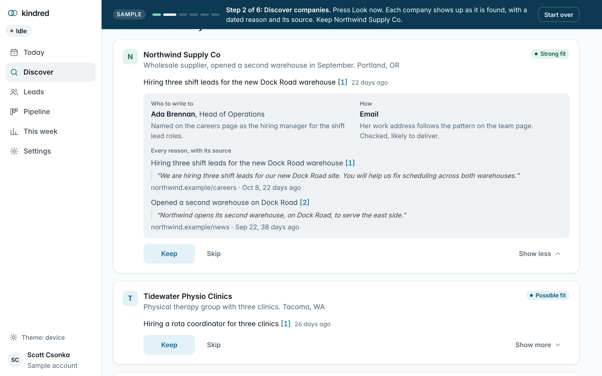
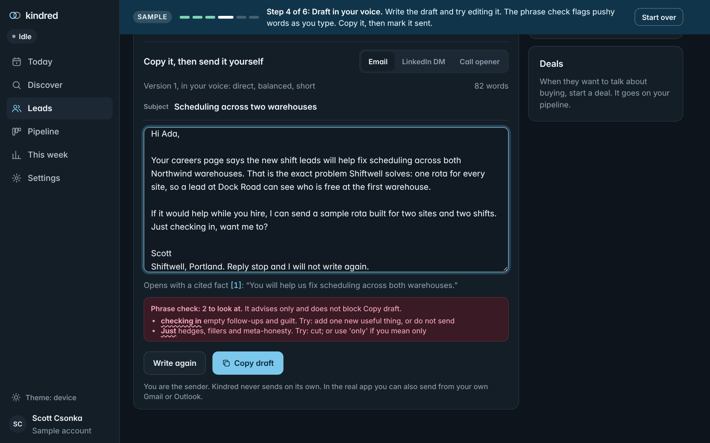
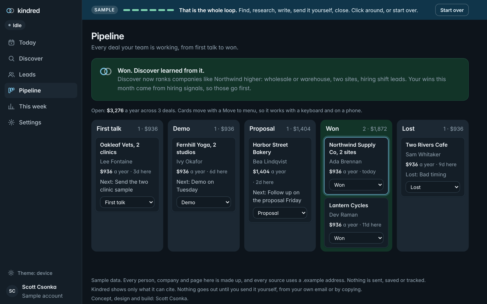

# Kindred: clickable sample

**Your next good customer, with the reasons attached.**

Kindred is a sales research app for founders who sell. It finds a few companies worth your time from public, dated signals, shows you why with sources you can check, and drafts a note in your voice. You send it yourself.

**[Try the sample in your browser](https://csonkascott.github.io/kindred-demo/)**. No sign up, takes about two minutes.

## What the sample walks through

A guided ribbon at the top takes you through six steps. The sample seller makes shift scheduling software for businesses with more than one site.

1. **Set up from your website.** One read of the seller's site fills in who to look for, with the reason for each line and the page it came from.
2. **Discover.** Companies show up as they are found. Each one has a fit rating and a dated reason with its source. Companies that don't qualify are left out, each with a reason.
3. **Research the lead.** Enrich saves a few public pages, then the brief covers why it fits, why now, who they are, what might stop them, and what Kindred could not find. Every line links to its source.
4. **Draft in your voice.** Email, LinkedIn DM or a call opener. A phrase check flags pushy or tired wording as you type. It advises only and never blocks you. There is no send button: you copy the draft and send it yourself.
5. **Handle the reply.** The reply shows up on Today with Kindred's read of it, and you can start a deal from it.
6. **Close it.** Move the deal across the pipeline. A win feeds back into what Discover looks for next.

| Discover | Brief |
| --- | --- |
|  |  |
| **Draft with phrase check (dark)** | **Pipeline after a win (dark)** |
|  |  |

## How Kindred is built

The real app is private. This repo holds only the sample.

- **Stack:** Next.js 15 and React 19 on Vercel, Supabase (Postgres with row level security, auth and storage), Stripe billing, and Claude for research and writing, with prompt caching and a trace for every model call.
- **Grounded output:** every claim in a brief or draft has to cite a saved source, or it is labelled as inferred. Gaps are stated, not guessed.
- **A person always sends:** Kindred never sends on its own. You copy the draft, or send it from your own Gmail or Outlook.
- **Quality gates:** Vitest unit tests, Playwright end to end runs against an in-memory Supabase stand-in, axe accessibility checks for WCAG 2.2 AA in light and dark, a phrase check on every draft, CodeQL, and secret scanning.

## About this sample

- Plain HTML, CSS and JavaScript. No build step, no backend, no network requests, no tracking. The only thing stored is your theme choice.
- Open `index.html` directly, or host the folder on any static host. Add `?theme=dark` or `?theme=light` to the address to force a theme.
- Works on phones, follows your device's light or dark setting, and respects reduced motion.
- The design tokens and the phrase list are copied from the real app.
- **Sample data:** every person, company and page is made up, and every source uses a `.example` address.

Concept, design and build: Scott Csonka, GTM Engineer.
